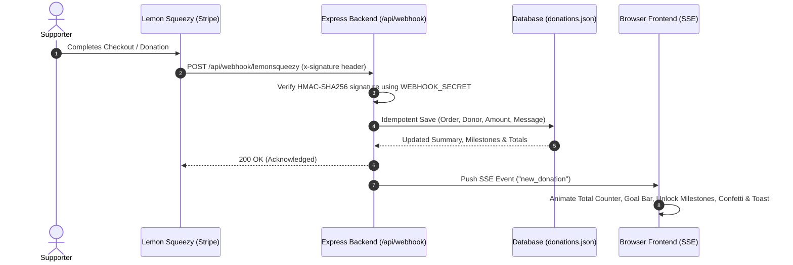

# 🌴 GTA VI Battle Station Crowdfunder — Real-Time Lemon Squeezy (Stripe) Tracker

A complete, production-ready, real-time donation tracking system built for your **GTA 6 Rig Crowdfunder**, integrated with **Lemon Squeezy** (which runs on Stripe under the hood).

Whenever a donation is completed via Lemon Squeezy checkout:
1. **Lemon Squeezy (Stripe)** sends a signed `order_created` webhook to your backend.
2. **Backend (Express)** verifies the HMAC-SHA256 signature, validates payment, and updates the database idempotently.
3. **Backend** instantly pushes the new total, budget progress, and donor information to all viewers via **Server-Sent Events (SSE)**.
4. **Frontend Dashboard** animates the raised amount, recalculates the target goal ($2,500 budget), unlocks hardware setup milestones (CPU, GPU, RAM, Monitor) in real time, and triggers confetti and celebration toasts.

---

## 🏗️ Architecture



---

## 🚀 Quick Start

### 1. Run the Server
```bash
npm start
```
Open **`http://localhost:3000`** in your browser.

### 2. Configure Environment (Optional)
The project works out of the box in dev mode. For production, edit `.env`:
```env
PORT=3000
LEMONSQUEEZY_WEBHOOK_SECRET=your_secret_here
DONATION_GOAL_CENTS=250000
LEMONSQUEEZY_CHECKOUT_URL=https://yourstore.lemonsqueezy.com/buy/...
```
*(You can also set or change your Lemon Squeezy checkout link directly in the web UI without restarting!)*

---

## ⚡ Lemon Squeezy Dashboard Configuration

### Step 1: Create a "Pay What You Want" Donation Product
1. Log in to your [Lemon Squeezy Dashboard](https://app.lemonsqueezy.com).
2. Go to **Store** &rarr; **Products** &rarr; **New Product**.
3. Set **Pricing model** to **Pay what you want**.
4. Set a minimum price (e.g., `$1.00`) and a suggested price (e.g., `$10.00`).
5. (Optional) In **Checkout fields**, add a custom text field labeled `donor_message` so supporters can leave a message with their donation.

### Step 2: Expose Your Local Server (For Local Development)
Lemon Squeezy needs a public HTTPS URL to deliver webhooks. You can use `ngrok` or Cloudflare Tunnel:
```bash
ngrok http 3000
```
Copy the generated HTTPS forwarding URL (e.g., `https://a1b2-c3d4.ngrok-free.app`).

### Step 3: Register the Webhook
1. In Lemon Squeezy, go to **Settings** &rarr; **Webhooks**.
2. Click **Add Webhook** (or **+**).
3. **Callback URL**: Enter `https://your-public-url/api/webhook/lemonsqueezy`.
4. **Signing Secret**: Enter a strong secret string (e.g., `lemon_secret_998877`).
5. **Events**: Select **`order_created`**.
6. Save the webhook.
7. Paste the signing secret into your `.env`:
   ```env
   LEMONSQUEEZY_WEBHOOK_SECRET=lemon_secret_998877
   ```
8. Restart your server.

---

## 🧪 Testing

### Option A: Interactive Web UI Simulator
Open `http://localhost:3000` and use the built-in **Test Donation Simulator** panel on the right sidebar. Click **"Send Simulated Donation"** to watch the counter, progress bar, confetti, and toast trigger immediately!

### Option B: Real HMAC-SHA256 Webhook Simulation Script
Run the provided CLI script to test exact Lemon Squeezy HMAC SHA-256 signature verification:
```bash
# Usage: node scripts/simulate-webhook.js [donorName] [amountDollars] [secret]
node scripts/simulate-webhook.js "Sarah Connor" 75 "lemon_secret_998877"
```

### Option C: Lemon Squeezy "Send Test Event"
In your Lemon Squeezy Webhooks settings page, click the **Send test event** button. Your server console will show:
```
[Webhook Received] Event: "order_created"
[New Donation] Test User donated $10.00! Total now: $10.00
```

---

## 📂 Project Structure

```
lemonsqueezy-donation-tracker/
├── .env                         # Secrets and environment configuration
├── .env.example                 # Example template
├── server.js                    # Express server, HMAC verification, SSE broadcaster
├── db.js                        # File-backed idempotent database layer
├── package.json
├── scripts/
│   └── simulate-webhook.js      # CLI tool to send HMAC-signed test webhooks
└── public/
    ├── index.html               # Live dashboard & goal visualizer
    ├── style.css                # Dark-mode glassmorphic styling
    └── app.js                   # EventSource SSE client & celebration effects
```

---

## 💡 Key Production Highlights

- **Raw Body Preservation for HMAC Verification**: Express parses JSON by default into an object, which invalidates raw byte signatures. This project uses `express.json({ verify: (req, res, buf) => { req.rawBody = buf; } })` to ensure 100% accurate timing-safe HMAC checks.
- **Timing-Safe Equals**: Uses `crypto.timingSafeEqual` to prevent timing attack vulnerabilities during webhook authentication.
- **Idempotent Storage**: If Lemon Squeezy retries a webhook due to a momentary network blip, the server detects the existing `orderId` and returns `200 OK` without double-counting donations.
- **Server-Sent Events (SSE)**: Built-in heartbeat pings prevent proxies, cloud load balancers, and mobile browsers from closing the live connection.

